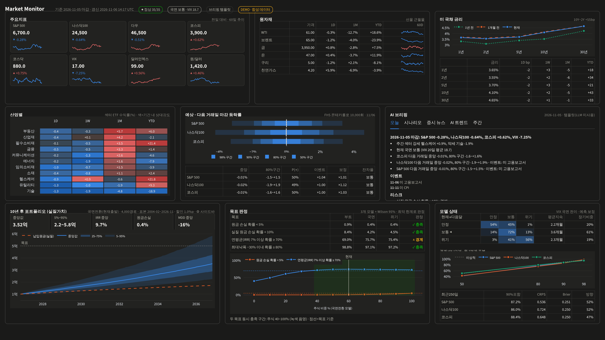

# Market Monitor

몬테카를로 기반 시장 모니터링 및 포트폴리오 확률 예측 대시보드입니다. 한 화면(1920×1080)에 다음을 보여줍니다.

- 1행: [주요지표] [원자재] [국채 1·2·5·10·30Y]
- 2행: [산업별] [예상: 다음 거래일 예측분포] [AI 브리핑: 오늘·시나리오·증시뉴스·AI트렌드·주간]
- 3행: [10년 포트폴리오] [목표 판정: "원금손실 < 5%", "IRR ≥ 7% 확률 ≥ 70%" 등] [모델 상태: VIX 국면 전이·예측 보정]


> 스크린샷은 `MM_OFFLINE=1` 합성 데이터로 찍은 것입니다. 실데이터에서는 DEMO 배지가 사라집니다.

## 구조

```
config/universe.yaml     패널별 티커 = 화면 구성 (YAML만 고치면 패널 항목이 바뀜)
config/events.yaml       이벤트 캘린더 (수동 + FRED 자동 + 실적 + 규칙)
src/mm/data/             store.py: Parquet 시계열 + SQLite 메타·수집로그·품질플래그
                         sources.py: Yahoo / FRED / Synthetic 어댑터
                         update.py: 증분 수집 (last_date − 10일부터 재수신해 수정치 반영)
src/mm/events/           calendar.py: 하이브리드 캘린더 + 이벤트별 변동성 배수(베이지안 축소추정)
src/mm/sim/              daily.py: FHS(EWMA σ × 경험적 표준화잔차) 다음 거래일 분포
                         portfolio.py: 정상 블록 부트스트랩 10년 시뮬(적립·리밸런싱·실질화)
src/mm/sim/regime.py     VIX 3국면(안정/보통/위기) Markov 전이 + 국면조건부 부트스트랩
src/mm/sim/goals.py      목표 확률 판정(3개 모델 × Wilson 95% 보수 판정) + 주식비중 탐색
src/mm/llm/briefing.py   Claude API(web_search + 구조화 출력) 일일 브리핑·시나리오 해설·주간 다이제스트
src/mm/eval/             calibration.py: 커버리지·CRPS·PIT·Brier + split-conformal 폭 보정
src/mm/pipeline.py       수집 → 이벤트 → 어제 예측 채점 → 오늘 예측 → 10년 시뮬 → status.json
app/dashboard.py         Streamlit 한 화면 (읽기 전용, 외부 호출 0회)
jobs/run.py              CLI: daily | update | events | backfill | forecast | portfolio | briefing | weekly | health
jobs/scheduler.py        상주 스케줄러: 07:15 KST(화~토, 미국장 후) / 16:10 KST(월~금, 한국장 후)
```

## 로컬 운영 확인 (Mac)

```bash
git clone https://github.com/khselect/market_monitor && cd market_monitor
bash scripts/local_check.sh          # .env 생성 → 키 입력 후 재실행: 테스트 → 실데이터 수집 → health → 대시보드
bash scripts/local_check.sh --docker # docker compose(worker+dashboard) 기동 → http://localhost:8502
```

`python -m jobs.run health`는 수집 오류, 데이터 지연(5일 초과), 채점 대기, LLM 실패를 점검하고, 문제가 있으면 exit 1을 반환합니다.

### 키 (.env)
| 키 | 용도 | 없을 때 |
|---|---|---|
| `FRED_API_KEY` | 경제지표 발표일정 자동수집 | 수동 YAML 일정만 사용 |
| `ANTHROPIC_API_KEY` | LLM 브리핑, 시나리오 해설, 주간 다이제스트 | 수치 기반 템플릿 브리핑 |
| `ALPHAVANTAGE_API_KEY` | Yahoo 실패 시 ETF 폴백(하루 20회 이내), 뉴스 감성 | 폴백 없음 |

### 일정 (worker 컨테이너)
- **07:15 KST (화~토):** 수집 → 예측 → 10년 시뮬과 목표 판정 → **LLM 일일 브리핑**
- **토 07:15:** 위 작업에 더해 **주간 다이제스트**(증시와 AI)를 만듭니다. 기존 주간 예약 작업 2개를 대체합니다.
- **16:10 KST (월~금):** 한국장 마감 후 수집과 예측만 실행합니다(브리핑 없음).
- **LLM 비용:** Claude 호출은 리서치 2회와 종합 1회로 하루 3회입니다. `MM_LLM_MODEL`로 모델을 바꿀 수 있습니다.

### Claude Code MCP
`.mcp.json`에 Alpha Vantage 원격 MCP(`https://mcp.alphavantage.co/mcp`, OAuth)가 등록되어 있습니다.
이 저장소에서 Claude Code를 열고 `/mcp`로 인증하면, 개발 중에 시세·지표·뉴스를 바로 조회할 수 있습니다.

## 로컬 실행 (수동)

```bash
python -m venv .venv && source .venv/bin/activate && pip install -r requirements.txt
cp .env.example .env              # FRED_API_KEY 입력 (무료)
python -m jobs.run daily          # 최초: 2000년~ 전체 수집 + 500일 워크포워드 백필
streamlit run app/dashboard.py
```

`MM_OFFLINE=1 python -m jobs.run daily`를 쓰면 네트워크 없이 합성 데이터로 실행됩니다.

## 운영 배포 (Mac mini · Docker · Cloudflare Tunnel)

```bash
docker compose up -d --build
```

- **서브도메인** (`market.sielain.com`, 기존 air/parts와 같은 방식): `MM_BASE_PATH`를 비워 두고
  Zero Trust → Tunnels → sielain-tunnel → Published application routes에서
  Subdomain `market` / URL `market_monitor_app:8501`을 추가합니다.
- **서브디렉토리** (`sielain.com/market`): `.env`에 `MM_BASE_PATH=market`을 넣고,
  route의 Path를 `market`, URL을 `market_monitor_app:8501`로 지정합니다.
  터널은 경로를 그대로 전달하므로 앱이 `/market` 접두사로 서비스해야 합니다.

## 이벤트 캘린더 유지보수
- **연 1회** (12월): `config/events.yaml`의 `manual`에 다음 해 FOMC와 금통위 일정을 추가합니다. 미확인 일정은 `status: tentative`로 둡니다.
- CPI·고용·GDP·PCE·PPI·소매판매는 FRED가 자동으로 수집합니다. 첫 실행 시 `fred_releases`의 release_id 이름을 확인하세요.
- 옵션만기(셋째 금요일)는 코드가 자동으로 생성합니다.
